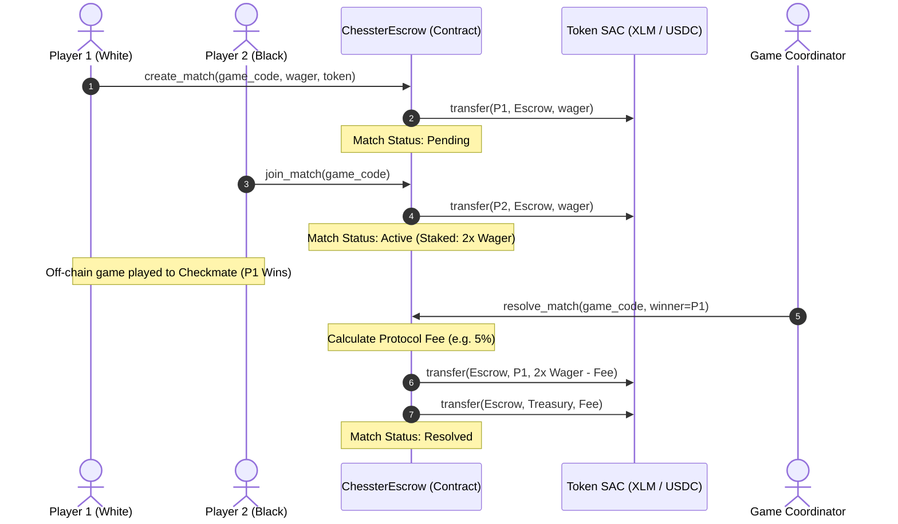
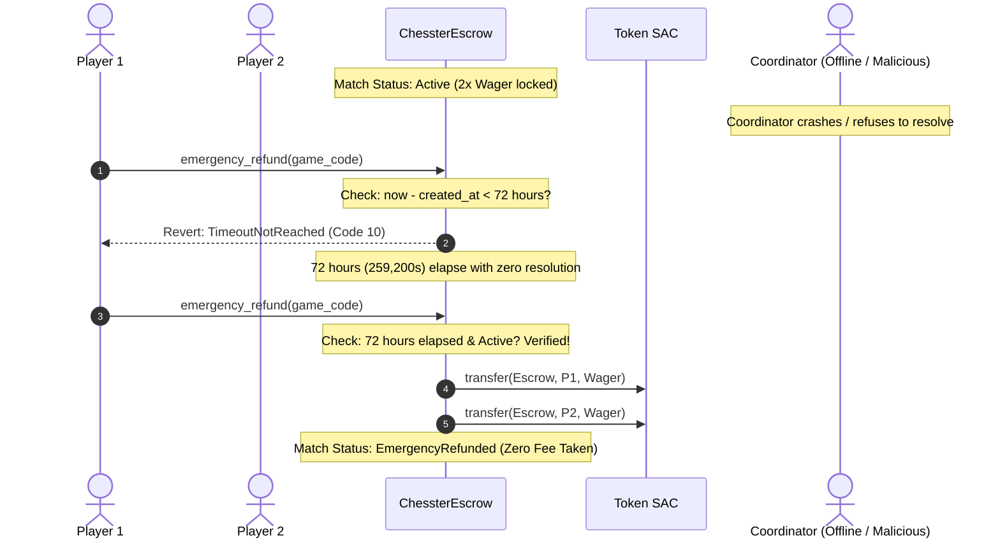
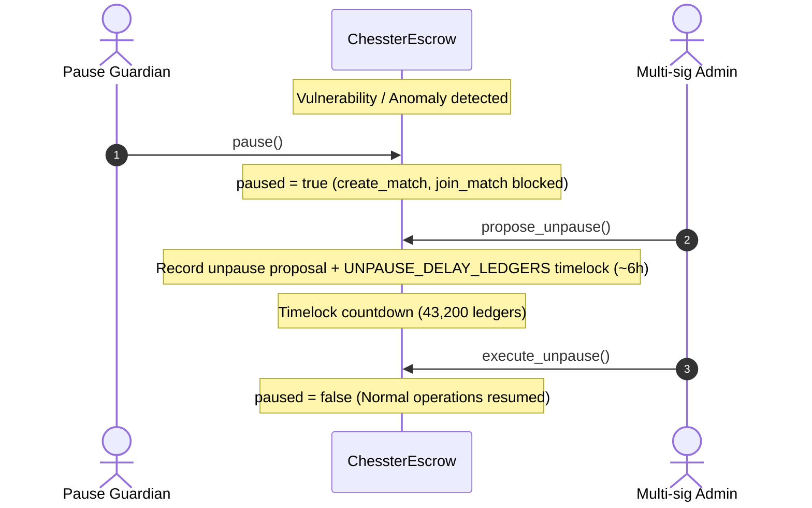

# Chesster Soroban Escrow: Security Model & Threat Analysis

This document provides the formal security specification, threat model, trust assumptions, and emergency operational procedures for the `ChessterEscrow` smart contract running on the Stellar network ([`contracts/soroban/contracts/escrow/src/lib.rs`](../contracts/soroban/contracts/escrow/src/lib.rs)).

For general architectural subsystems and component interactions, refer to [`ARCHITECTURE.md`](./ARCHITECTURE.md). For contract storage keys and error codes, refer to [`SOROBAN_INTEGRATION.md`](./SOROBAN_INTEGRATION.md).

---

## 1. Executive Summary & Scope

The `ChessterEscrow` contract manages financial escrow for decentralized chess matches, tournament prize pools, and spectator side wagers on Stellar/Soroban. The primary security objectives are:

1. **Zero-Loss of Player Principal**: Player and spectator funds locked in escrow must never be permanently trapped or siphoned, even under coordinator abandonment, network partition, or administrative compromise.
2. **Deterministic Settlement Integrity**: Payouts must strictly follow verified match results, mutual player agreement, or verifiable cryptographic proofs (coordinator Ed25519 signatures).
3. **Defense-in-Depth & Graceful Degradation**: Multi-tier timelocks, circuit breakers, and multisig governance provide bounded containment if off-chain components fail.

---

## 2. System Architecture & Component Boundaries

```text
┌────────────────────────────────────────────────────────────────────────┐
│                          Trust Boundary                                │
│                                                                        │
│   ┌───────────────┐                  ┌─────────────────────────────┐   │
│   │ Player Client │ (Web / Mobile)   │ Spectator Client (Bettor)   │   │
│   └───────┬───────┘                  └──────────────┬──────────────┘   │
│           │ Signed Tx (Freighter)                   │ Signed Tx        │
│           ▼                                         ▼                  │
│   ┌────────────────────────────────────────────────────────────┐       │
│   │               Stellar / Soroban Host Network               │       │
│   │                                                            │       │
│   │    ┌──────────────────────────────────────────────────┐    │       │
│   │    │          ChessterEscrow Smart Contract           │    │       │
│   │    │                                                  │    │       │
│   │    │  - Match & Tournament State Machine              │    │       │
│   │    │  - Spectator Side Pool Ledger                    │    │       │
│   │    │  - Timelocked Dispute & Refund Engine            │    │       │
│   │    │  - Circuit Breaker & Multisig Guardian Registry  │    │       │
│   │    └────────────────────────▲─────────────────────────┘    │       │
│   └─────────────────────────────┼──────────────────────────────┘       │
└─────────────────────────────────┼──────────────────────────────────────┘
                                  │ Signed Resolution / Auth
                        ┌─────────┴─────────┐
                        │  Game Coordinator │ (Chesster Backend)
                        │  Engine (Stockfish│
                        │  Move Validation) │
                        └───────────────────┘
```

---

## 3. System Roles & Trust Assumptions

| Role | Entity / Key Type | Responsibilities & Capabilities | Trust Level | Mitigations Against Malice / Compromise |
| --- | --- | --- | --- | --- |
| **Master Admin** | Multi-sig / Governance Key | Initialization, token whitelisting, platform fee rate configuration, fee treasury designation. | **Privileged** | Fee rate capped on-chain (`MAX_ASSET_FEE_BPS = 1,000` / 10%). Token additions require whitelist approval. Cannot confiscate active player stakes. |
| **Pause Guardian Set** | M-of-N Multisig (`guardians`, `g_thr`) | Immediate circuit breaker activation (`pause`) to freeze contract deposits/joins during critical vulnerabilities. | **Semi-Trusted** | Can only halt new activity; cannot divert funds. Unpause is subject to a mandatory timelock delay (`UNPAUSE_DELAY_LEDGERS = 43,200` ~ 6 hours). |
| **Game Coordinator** | Hot Key (Address + Ed25519 `pubkey`) | Submits authoritative match results (`resolve_match`, `resolve_match_with_signature`), cancels aborted matches, handles timeout forfeits. | **Semi-Trusted** | Coordinator cannot alter winner address outside of `{player1, player2}`. Inactivity for >72 hours triggers unilateral player emergency refund (`EMERGENCY_TIMEOUT_SECONDS`). Key rotation requires guardian multisig approval (`pend_rot`). |
| **Players** | Ed25519 Keypair (Freighter) | Self-custodial game creation (`create_match`), joining (`join_match`), mutual cancellation proposals, dispute raising, emergency refund claims. | **Untrusted** | Every transfer and state transition requires explicit `Address::require_auth()`. Max concurrent active games capped (`MaxActiveMatchesReached = 5`). |
| **Spectators** | Ed25519 Keypair (Freighter) | Wager on match outcomes (`bet_on_match`), claim pro-rata shares (`claim_side_bet`). | **Untrusted** | Isolated side pools (`SideBetLedger`). Stakes closed once match enters `Active` state. Unclaimed pool payouts outlive match records. |

---

## 4. Key Security Invariants

The `ChessterEscrow` implementation enforces the following formal invariants:

### Invariant 1: Total Reserve Solvency
The contract's token balance for any supported asset $A$ must always be greater than or equal to the sum of all currently un-refunded, un-settled liabilities:

$$\text{TokenBalance}(A) \ge \sum_{m \in \text{Matches}(A)} \text{LockedStake}(m) + \sum_{s \in \text{SidePools}(A)} \text{UnclaimedPool}(s) + \text{AccruedRake}(A)$$

- **Enforcement**: Tracked via instance counter `(lk_tok, token)` updated atomically on every deposit, payout, refund, and fee collection.
- **Verification**: Tested via property tests in `contracts/soroban/contracts/escrow/src/test.rs`.

### Invariant 2: Explicit Authorization (`require_auth`)
No state change, token movement, or parameter update can occur without explicit cryptographic authorization by the legitimate owner of that capability:
- Depositing wagers requires `player.require_auth()`.
- Resolving matches requires `coordinator.require_auth()` or a valid Ed25519 signature verified against stored `pubkey`.
- Mutual cancellations require explicit approval by both players.
- Admin actions require `admin.require_auth()`.

### Invariant 3: Anti-Lock Timelock Protection
Player funds can **never** be indefinitely trapped in an `Active` match:
- If a match is `Pending` and no opponent joins, Player 1 can reclaim 100% of their deposit after `MATCH_EXPIRATION_SECS` (1 hour) via `refund_after_timeout`.
- If a match is `Active` and the coordinator goes offline or fails to settle, either player can invoke `emergency_refund` after `EMERGENCY_TIMEOUT_SECONDS` (72 hours = 259,200s), splitting the locked escrow 50/50 without requiring coordinator involvement.

### Invariant 4: Native Soroban Reentrancy Immunity
Soroban contracts run within a deterministic WebAssembly runtime with isolated call frames. Cross-contract calls cannot recursively enter the caller frame with stale state. Furthermore, the contract strictly adheres to the **Checks-Effects-Interactions (CEI)** pattern: all internal match states are marked `Resolved` or `Refunded` before external token transfers are dispatched.

### Invariant 5: Integer Safety & Arithmetic Bounds
All financial arithmetic uses 128-bit signed integers (`i128`) with safe bounds checking:
- Platform fees are calculated using checked division against `BPS_DENOMINATOR = 10_000`.
- Fee basis points are strictly capped:
  - Game rake: $\le \text{MAX\_ASSET\_FEE\_BPS}$ (1,000 bps / 10%).
  - Tournament fee: $\le \text{MAX\_TOURNAMENT\_FEE\_BPS}$ (500 bps / 5%).
  - Spectator pool fee: $\le \text{MAX\_SIDE\_BET\_FEE\_BPS}$ (500 bps / 5%).
- Wager amounts are bounded by `(min_wager, max_wager)` per asset.

### Invariant 6: Storage TTL Extension
To prevent premature ledger state archival by the Stellar network:
- Persistent entries (matches, side pools, player ratings) are automatically extended via `bump_entry_ttl(STORAGE_TTL_THRESHOLD, STORAGE_TTL_EXTENDED)` (~6 days threshold, ~30 days bump) whenever accessed.

---

## 5. Threat Model & STRIDE Analysis

| Threat Category | Potential Attack Vector | Impact | Mitigations Implemented in Contract |
| --- | --- | --- | --- |
| **Spoofing** | Adversary attempts to forge coordinator resolution or replay past match signatures. | High: Unauthorized drain of match wagers. | - Verification of coordinator authorization via `Address::require_auth()` or Ed25519 `verify_sig_ed25519`.<br>- Nonces and game codes are unique and invalidated upon resolution (`AlreadyResolvedOrRefunded`). |
| **Tampering** | Rogue actor attempts to modify match wager or declare an invalid winner address. | Critical: Stolen funds. | - Winner must strictly be `player1` or `player2` (`InvalidWinner`).<br>- Wager amounts locked in storage and checked against token balance on join. |
| **Repudiation** | Player claims they did not deposit or attempts double-spending wager funds. | Medium: Disputes. | - Deposits pull funds directly from the player's account via Stellar Asset Contract transfer with `player.require_auth()`.<br>- Emits indexed on-chain events (`MatchCreated`, `MatchJoined`). |
| **Information Disclosure** | Competitors attempt to front-run spectator bets or deanonymize private lobbies. | Low: Front-running odds. | - Side betting pools close immediately once match status transitions from `Pending` to `Active`.<br>- All on-chain state is auditable; off-chain lobby passwords remain hashed. |
| **Denial of Service** | Malicious player creates hundreds of dummy matches to bloat contract storage or exhaust coordinator. | Medium: Resource exhaustion. | - `MaxActiveMatchesReached` limit (5 concurrent active games per player).<br>- Stale resolved/refunded matches garbage collected via `batch_gc_stale_matches` (`MAX_BATCH_GC_MATCHES = 25`).<br>- Abandoned pending matches expire and are refunded after 1 hour (`MATCH_EXPIRATION_SECS`). |
| **Elevation of Privilege** | Malicious actor attempts to unpause contract or rotate coordinator keys without multisig. | Critical: Governance takeover. | - Pause can be triggered by guardian, but unpause enforces `UNPAUSE_DELAY_LEDGERS` timelock.<br>- Key rotation requires approval from threshold $M$-of-$N$ guardians (`pend_rot`).<br>- Emergency vault drain enforces a 7-day timelock (`EMERGENCY_DRAIN_TIMELOCK_SECS = 604,800s`). |

---

## 6. Workflows & Sequence Diagrams

### 6.1 Standard Match Lifecycle & Coordinator Settlement



---

### 6.2 Coordinator Outage: Timelocked Emergency Refund (72 Hours)



---

### 6.3 Circuit Breaker: Guardian Emergency Pause & Timelocked Unpause



---

### 6.4 Dispute & Timelocked Resolution Workflow (48 Hours)

```mermaid
sequenceDiagram
    autonumber
    actor P as Disputing Player
    participant C as ChessterEscrow
    actor Arb as Authorized Arbitrator
    participant T as Token SAC

    P->>C: raise_dispute(game_code, reason)
    Note over C: Match Flagged: Disputed
    Note over C: DISPUTE_TIMELOCK_SECS (48h) initiated

    Arb->>C: resolve_dispute(game_code, outcome)
    Note over C: Check: 48h timelock active?
    C-->>Arb: Revert: DisputeTimeLockActive (Code 25)

    Note over C: 48 hours elapse; evidence reviewed

    Arb->>C: resolve_dispute(game_code, outcome)
    C->>T: transfer(Escrow, recipient, payout)
    Note over C: Dispute Closed
```

---

## 7. Emergency Incident Response Playbooks

### Playbook A: Off-Chain Coordinator Key Compromise
1. **Immediate Quarantine**: Any authorized guardian calls `pause()` to halt all new matches and spectator betting.
2. **Propose Key Rotation**: Master Admin initiates `propose_coordinator_rotation(new_coordinator_address, new_pubkey)`.
3. **Multisig Approval**: Guardians review the incident and sign `approve_coordinator_rotation()`.
4. **Active Game Resolution**: Existing active games are reviewed; uncompromised matches are settled, disputed matches enter the 48-hour dispute quarantine.
5. **Resume**: Once rotation is verified, the admin initiates `propose_unpause()` and executes after the 6-hour delay.

### Playbook B: Permanent Coordinator Loss (Host Failure)
1. **No Admin Action Required for Player Funds**:
   - For all active matches, players simply wait for `EMERGENCY_TIMEOUT_SECONDS` (72 hours).
   - Once the timeout elapses, any player executes `emergency_refund(game_code)` to receive their original wager back in full.
2. **Pending Matches**:
   - Any player with an unjoined game calls `refund_after_timeout(game_code)` after 1 hour to reclaim their deposit.

### Playbook C: Contract Migration / Emergency Vault Drain
1. **Drain Proposal**: Admin invokes `schedule_emergency_drain(vault_address)`.
2. **Timelock Window**: Contract enters a mandatory 7-day timelock (`EMERGENCY_DRAIN_TIMELOCK_SECS = 604,800s`).
3. **Public Audit**: Players and auditors have 7 full days to observe the on-chain scheduled drain and self-refund any active matches before execution.
4. **Execution**: After 7 days, `execute_emergency_drain(token)` sends residual contract reserves to the designated cold vault.

---

## 8. Verification & Audit History

The invariants and security mechanisms documented above are verified continuously in CI via:
- **Unit & Integration Suite**: `contracts/soroban/contracts/escrow/src/test.rs`
- **Extended Test Suite**: `contracts/soroban/contracts/escrow/src/extended_tests.rs`
- **Contract Error Handling**: `contracts/soroban/contracts/escrow/src/error_tests.rs`
- **Formal Invariant Property Testing**: Executed using `proptest` on random match states, timeout variations, and boundary wagers.
